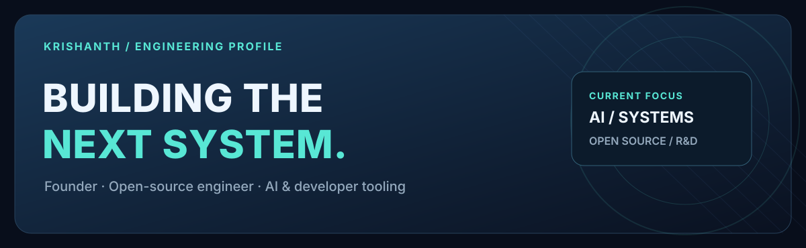
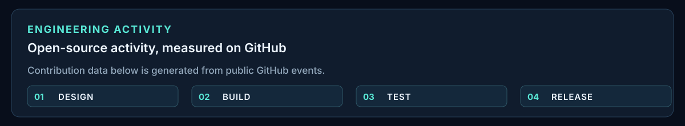
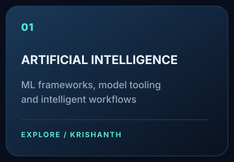
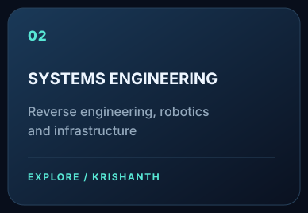
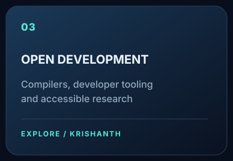
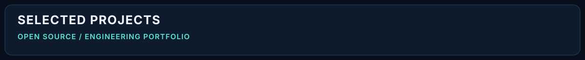
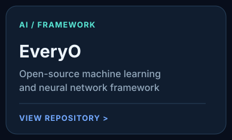
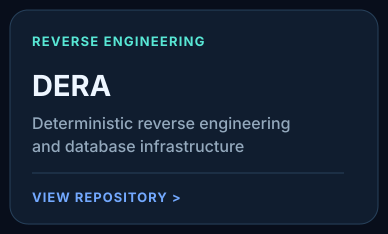
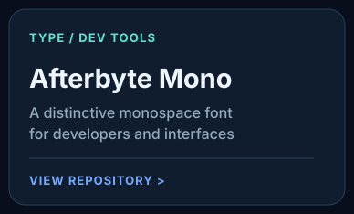

<!-- Original custom-designed GitHub profile dashboard for Krishanth. -->

  
  

    
    
    
  

  
  

  

  
  

### About

I’m **Krishanth** — a founder and open-source builder working on **AI, developer infrastructure, reverse engineering, programming languages, and autonomous systems**. I enjoy understanding technology from first principles and turning ambitious engineering ideas into useful, well-designed tools.

### Technology stack

  

### GitHub at a glance

  
  
  

---

  <a href="https://github.com/krishanth7?tab=repositories">Repositories</a> &nbsp; / &nbsp;
  <a href="https://x.com/krishanthb7">X</a> &nbsp; / &nbsp;
  <a href="https://github.com/sponsors/krishanth7">Sponsor development</a>
  
Designed for builders. Built in the open.

