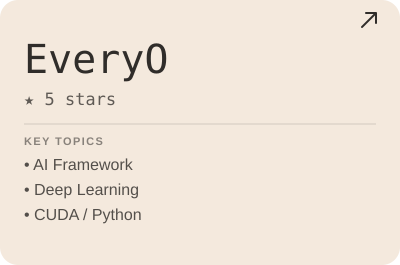
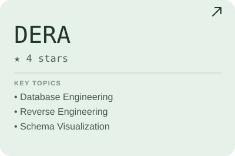
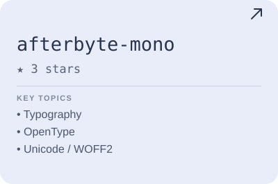

  

<table width="100%" cellspacing="10" cellpadding="0">
  <tr>
    <td width="33.33%" valign="top"></td>
    <td width="33.33%" valign="top"></td>
    <td width="33.33%" valign="top"></td>
  </tr>
</table>
